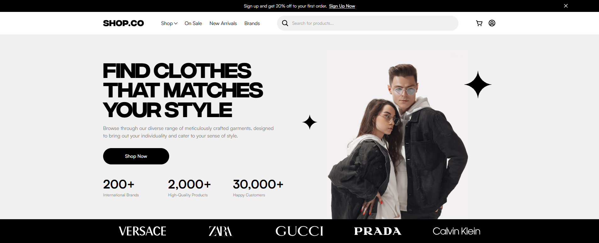
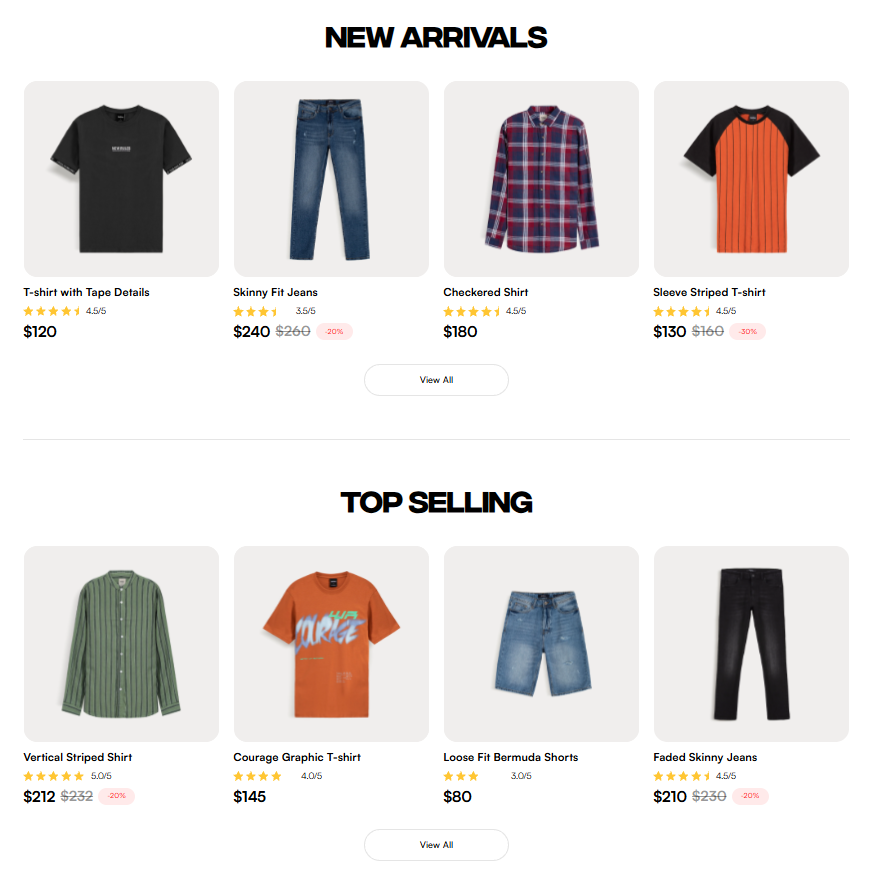
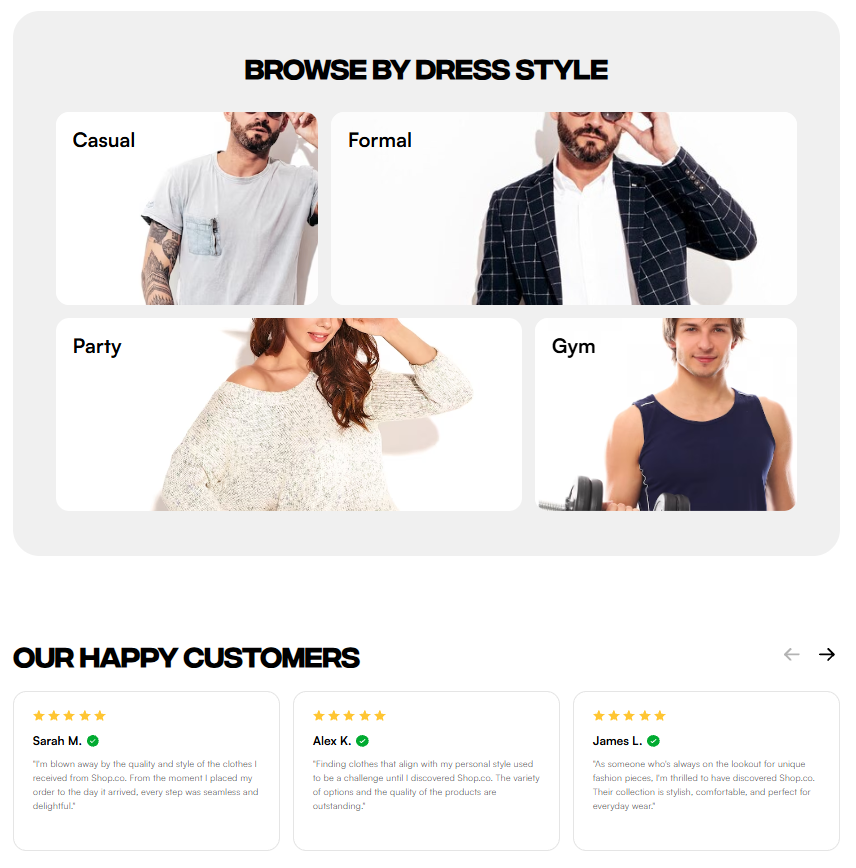
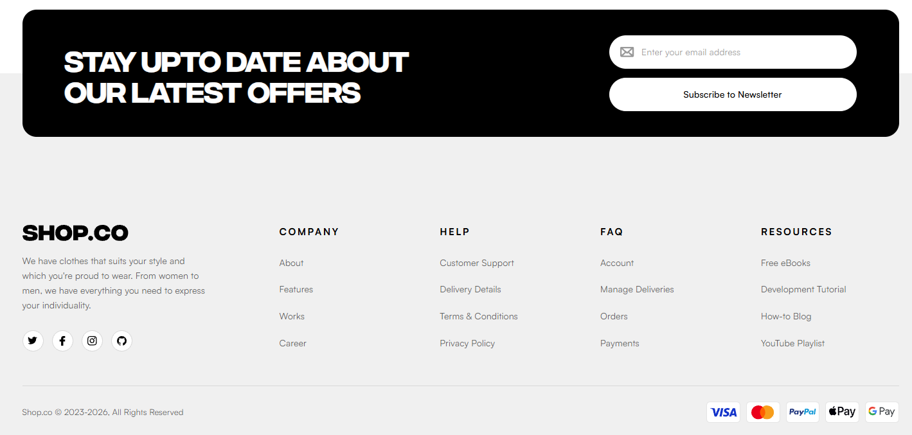
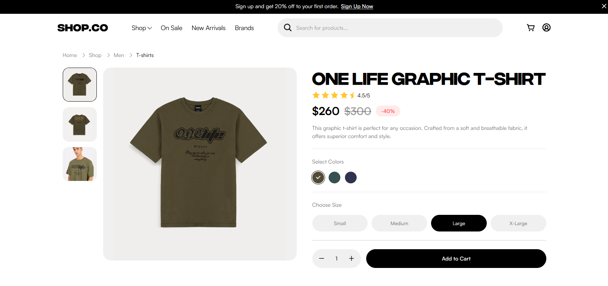
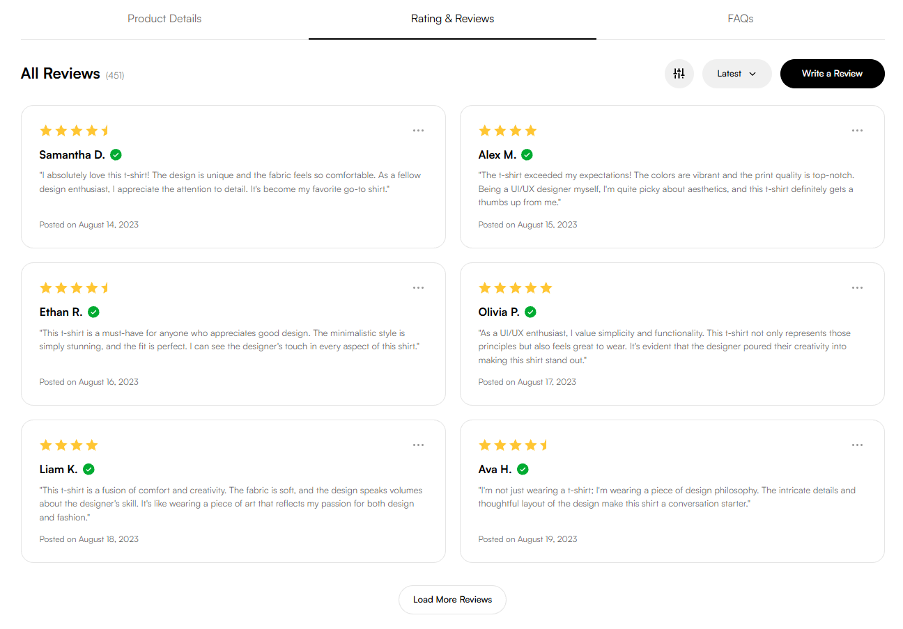
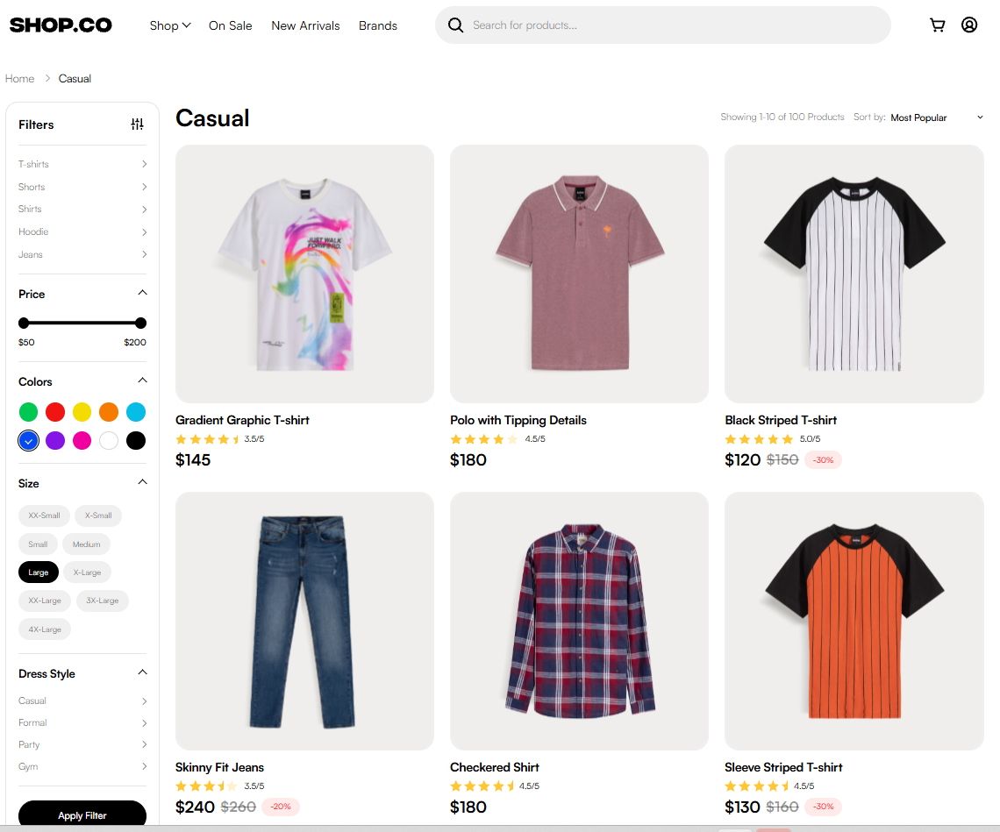
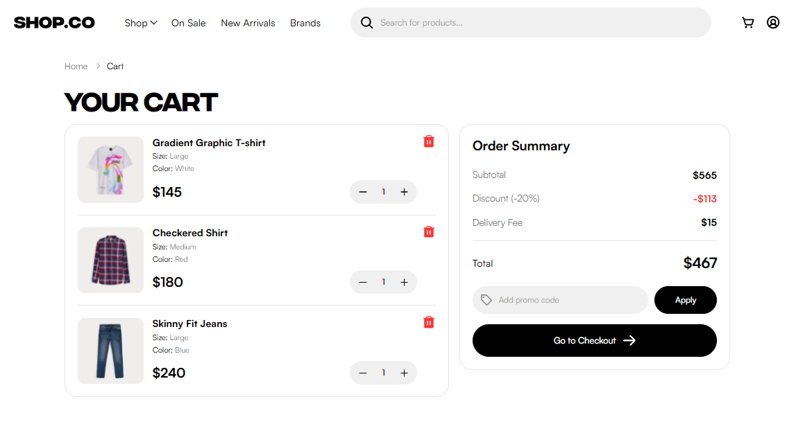

<h1 align="center">SHOP.CO — Fashion E-Commerce Website</h1>

<p align="center">
  A responsive, frontend-focused fashion e-commerce storefront built with HTML, CSS, and vanilla JavaScript.
</p>

<p align="center">
  <a href="https://shopco-website-one.vercel.app/">Live Demo</a>
  &nbsp;·&nbsp;
  <a href="https://github.com/mhsakibb/E-Commerce-Website-">GitHub Repository</a>
</p>

<p align="center">
  
  
  
  
  
</p>

---

## Table of Contents

<details>
  <summary><strong>Show / Hide Table of Contents</strong></summary>

  - [Project Overview](#project-overview)
  - [Key Features](#key-features)
  - [Pages and Screenshots](#pages-and-screenshots)
    - [Home Page](#1-home-page)
    - [Product Details Page](#2-product-details-page)
    - [Category Page](#3-category-page)
    - [Cart Page](#4-cart-page)
  - [Technology Stack](#technology-stack)
  - [Project Structure](#project-structure)
  - [Run Locally](#run-locally)
  - [Current Scope and Limitations](#current-scope-and-limitations)
</details>

---

## Project Overview

**SHOP.CO** is a frontend-focused fashion e-commerce website that presents a modern online shopping experience. The interface is organized into four connected pages: a home page, product details page, category listing page, and shopping cart page.

The project focuses on responsive layouts, product presentation, page navigation, and interactive user-interface elements using **HTML5, CSS3, and vanilla JavaScript**. Product information and cart items are currently static sample content; no backend or database is connected.

## Key Features

- Responsive storefront layout for desktop and mobile screen sizes.
- Shared announcement bar, navigation header, search interface, and footer design.
- Mobile navigation menu with open, close, outside-click, and Escape-key handling.
- Product cards with product images, ratings, prices, and discount labels.
- Product image gallery with selectable thumbnails.
- Interactive product color, size, and quantity controls.
- Category filter interface with collapsible groups, color and size selections, and price-range controls.
- Shopping cart quantity updates, item removal, empty-cart state, and automatic order-summary calculations.
- Customer testimonial carousel with previous and next controls.
- Semantic HTML elements and accessibility attributes for key controls.

## Pages and Screenshots

### 1. Home Page

The home page introduces the SHOP.CO storefront and highlights featured products, shopping categories, customer feedback, and newsletter content.

**Main Sections**

- **Announcement Bar and Header:** Promotional message, SHOP.CO logo, navigation links, search interface, and shopping-related actions.
- **Hero Section:** Main promotional heading, supporting description, shopping call-to-action, and store statistics.
- **Brand Strip:** Brand logos displayed below the hero section.
- **New Arrivals:** Product cards showing product images, names, ratings, prices, and available discount information.
- **Top Selling:** A separate product collection featuring popular items.
- **Browse by Dress Style:** Visual category cards for Casual, Formal, Party, and Gym styles.
- **Happy Customers:** Customer testimonials displayed in a horizontally scrollable carousel.
- **Newsletter and Footer:** Email subscription form and footer navigation grouped into relevant sections.

**Screenshots**

<p align="center">
  
</p>
<p align="center"><sub>01 — Header, Hero Section, and Brand Strip</sub></p>

<p align="center">
  
</p>
<p align="center"><sub>02 — New Arrivals and Top Selling</sub></p>

<p align="center">
  
</p>
<p align="center"><sub>03 — Browse by Dress Style and Happy Customers</sub></p>

<p align="center">
  
</p>
<p align="center"><sub>04 — Newsletter and Footer</sub></p>

### 2. Product Details Page

The product details page presents an individual product with its images, pricing, available options, and customer review section.

**Main Sections and Interactions**

- **Breadcrumb Navigation:** Shows the product's position within the shopping navigation hierarchy.
- **Product Image Gallery:** Displays front, back, and model views. Selecting a thumbnail updates the main product image.
- **Product Information:** Shows the product name, star rating, current price, original price, discount, and description.
- **Color Selection:** Allows a visitor to select a displayed product color.
- **Size Selection:** Provides selectable size options.
- **Quantity Selector:** Increases or decreases the displayed product quantity, with a minimum quantity of one.
- **Add to Cart Link:** Navigates to the cart page.
- **Product Content and Reviews:** Includes Product Details, Rating & Reviews, and FAQs tab elements, along with a customer review listing and review-related controls.

**Screenshots**

<p align="center">
  
</p>
<p align="center"><sub>01 — Product Breadcrumb and Product Overview</sub></p>

<p align="center">
  
</p>
<p align="center"><sub>02 — Product Tabs and Customer Reviews</sub></p>

### 3. Category Page

The category page displays a product collection with a filter sidebar and product-listing layout.

**Main Sections and Interactions**

- **Breadcrumb Navigation:** Provides a link back to the home page and identifies the current category.
- **Filter Sidebar:** Contains category links and product filter groups.
- **Filter Controls:** Includes color selection, size selection, and minimum/maximum price controls.
- **Mobile Filter Drawer:** Opens as an overlay on smaller screens and can be closed using its close control, the overlay, or the Escape key.
- **Product Sorting Interface:** Displays sorting options for popularity, latest products, and price order.
- **Product Grid:** Shows product images, names, ratings, and prices. Product cards link to the product details page.
- **Pagination Interface:** Displays page navigation controls.

**Screenshot**

<p align="center">
  
</p>
<p align="center"><sub>01 — Category Product Listing</sub></p>

### 4. Cart Page

The cart page provides a shopping-cart layout with sample products and an order summary.

**Main Sections and Interactions**

- **Cart Items:** Displays each sample product with its image, name, selected size, color, and price.
- **Quantity Controls:** Increases or decreases the quantity of an item.
- **Remove Item:** Removes the selected item from the visible cart list.
- **Order Summary:** Recalculates the subtotal, 20% discount, delivery fee, and final total when quantities change or an item is removed.
- **Empty Cart State:** Displays a message and a Continue Shopping link when all items have been removed.
- **Promo Code Interface:** Provides a promo-code input and feedback area; code validation is not connected yet.
- **Checkout Button:** Provides the checkout navigation entry point.

**Screenshot**

<p align="center">
  
</p>
<p align="center"><sub>01 — Shopping Cart and Order Summary</sub></p>

## Technology Stack

| Technology | Purpose |
|---|---|
| **HTML5** | Page structure, semantic sections, forms, navigation, and content. |
| **CSS3** | Page layouts, typography, styling, responsive behavior, and visual components. |
| **Vanilla JavaScript** | DOM interactions, mobile navigation, testimonial scrolling, product options, filter controls, and cart calculations. |
| **Satoshi and Integral CF Fonts** | Typography loaded through external font stylesheets. |
| **Vercel** | Live deployment and hosting. |

## Project Structure

<details>
  <summary><strong>Show / Hide Project File Structure</strong></summary>

  ```text
  E-Commerce-Website-/
  │
  ├── assets/
  │   ├── icons/                 # Interface icons and SVG controls
  │   ├── images/                # Product, banner, category, and customer images
  │   └── logos/                 # SHOP.CO and brand logos
  │
  ├── css/
  │   ├── styles.css            # Home page styles
  │   ├── product-details.css   # Product details page styles
  │   ├── category.css          # Category page styles
  │   └── cart.css              # Cart page styles
  │
  ├── screenshots/              # Project screenshots used in this README
  │   ├── home-01-header-hero-brand-strip.png
  │   ├── home-02-new-arrivals-top-selling.png
  │   ├── home-03-dress-style-happy-customers.png
  │   ├── home-04-newsletter-footer.png
  │   ├── product-details-01-breadcrumb-overview.png
  │   ├── product-details-02-tabs-customer-reviews.png
  │   ├── category-01-category-listing.png
  │   └── cart-01-shopping-cart.png
  │
  ├── index.html                 # Home page
  ├── product-details.html       # Product details page
  ├── category.html              # Category listing page
  ├── cart.html                  # Shopping cart page
  ├── script.js                  # JavaScript interactions across pages
  └── README.md                  # Project documentation
  ```
</details>

## Run Locally

The project uses plain HTML, CSS, and JavaScript. No package installation or build process is required.

1. Clone the repository:

   ```bash
   git clone https://github.com/mhsakibb/E-Commerce-Website-.git
   ```

2. Open the project folder:

   ```bash
   cd E-Commerce-Website-
   ```

3. Open `index.html` in a browser, or use the **Live Server** extension in Visual Studio Code.

The other pages can be opened directly or reached through the website's page links.

## Current Scope and Limitations

This repository is a **frontend prototype**, not a complete production e-commerce system.

- Product details, category products, and cart items are sample content defined in the HTML pages.
- The Add to Cart link navigates to `cart.html`; it does not transfer the selected product or quantity into a shared cart state.
- Category filter controls provide interactive selection and drawer behavior, but applying filters is not connected to product-data filtering. Sorting and pagination are currently interface elements.
- The promo-code field displays a message because promo-code validation has not been implemented.
- The checkout button currently points to `checkout.html`, but a checkout page is not included in this repository.
- Newsletter submission, user accounts, payment processing, backend APIs, database storage, and persistent cart storage are not implemented.

---

<p align="center">
  <strong>SHOP.CO</strong><br />
  Frontend E-Commerce Website
</p>

<p align="center">
  <a href="https://shopco-website-one.vercel.app/">Live Demo</a>
  &nbsp;·&nbsp;
  <a href="https://github.com/mhsakibb/E-Commerce-Website-">GitHub Repository</a>
</p>
